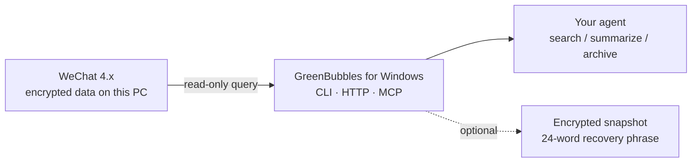

<p align="center">
  
</p>

<h1 align="center">GreenBubbles for Windows</h1>

<p align="center">
  <strong>Let your agents read your own WeChat history. Locally.</strong><br>
  Read-only CLI + HTTP connector + MCP server for Windows WeChat 4.x.<br>
  No export step. No second copy to keep in sync.
</p>

<p align="center">
  <a href="#install">Install</a> ·
  <a href="#usage">CLI usage</a> ·
  <a href="#agent-access">Agent access</a> ·
  <a href="#archive-and-snapshot">Archive</a> ·
  <a href="https://github.com/bojieli/greenbubbles">Upstream</a> ·
  <a href="#contributors">Contributors</a> ·
  <a href="docs/README.md">Docs</a> ·
  <a href="README.zh-CN.md">中文</a> ·
  <a href="CONTRIBUTING.md">Contribute</a>
</p>

<p align="center">
  <a href="https://github.com/seaneer/greenbubbles-win/actions/workflows/ci.yml"></a>
  <a href="https://github.com/seaneer/greenbubbles-win/releases"></a>
  <a href="LICENSE"></a>
  
  
  
  
</p>



<sub>Architecture is rendered from Markdown (Mermaid), so it does not depend on an image CDN. Static fallback: [assets/architecture.png](assets/architecture.png); design notes: [docs/ARCHITECTURE.md](docs/ARCHITECTURE.md).</sub>

> **Upstream reference:** [GreenBubbles for macOS by Bojie Li](https://github.com/bojieli/greenbubbles) (MIT). This repository is an independent Windows implementation, not a fork or a Windows branch of upstream.

GreenBubbles for Windows is an independent Windows implementation of the macOS
project [GreenBubbles](https://github.com/bojieli/greenbubbles) by Bojie Li. It
reads the databases WeChat 4.x already keeps on your PC. It never changes
WeChat's files and never keeps an exported chat database in sync. Point it at a
contact or group and a time window; it decrypts only what is needed and returns
`greenbubbles.query.v1` JSON.

It aligns with the upstream query envelope, message-type mapping, `sortSequence`
ordering and MCP tool names, but contains no Swift code from upstream.

**Beta. Windows 10/11 x64, WeChat 4.x.** The portable ZIP ships with Python 3.12;
end users do not need Python, pip or Visual Studio.

## What you can do

- **Browse and search:** list conversations, read messages, search locally, and open attachments.
- **Give an agent a narrow window:** query one contact or group for a time range over HTTP or MCP.
- **Archive:** export Markdown, JSONL and HTML with attachment files, incrementally.
- **Back up:** create an encrypted snapshot unlocked by a 24-word recovery phrase.
- **Stay offline:** keys, decryption, search and archives stay on this machine.

## Upstream and differences

| Item | Upstream (macOS) | This project (Windows) |
| --- | --- | --- |
| Platform | macOS 14+ | Windows 10/11 x64 |
| Implementation | Swift + SQLCipher | Python 3.10+ |
| Data source | macOS WeChat | Windows WeChat 4.x (tested on 4.1.11.24) |
| Entry points | Swift CLI / GUI | CLI + HTTP connector + MCP |
| Query contract | `greenbubbles.query.v1` | Same name and semantics; fields are additive only |
| Code relation | MIT | Independent implementation; no upstream Swift source |

This is not a Windows branch of upstream, and command-for-command parity is not
guaranteed. The contract that is intentionally aligned is the query envelope,
message-type mapping, `sortSequence` ordering and MCP tool names.

## Requirements

| Role | Requirements |
| --- | --- |
| End user | Windows 10/11 x64; WeChat 4.x; unzip the portable package; no Python needed |
| Developer | Windows 10/11 x64; Python 3.10+; pip; Git |
| Privileges | Normally a standard user; if WeChat runs elevated, run this tool elevated too |
| Architecture | x64 only; ARM64 is not verified |
| Network | No internet required; HTTP binds to `127.0.0.1` by default |

## Install

1. Download `greenbubbles-win-<version>-portable.zip` from [Releases](https://github.com/seaneer/greenbubbles-win/releases).
2. Unzip it anywhere.
3. Sign in to WeChat and keep it running.
4. Check access:

```powershell
.\greenbubbles.cmd source status
```

The first run captures the database key from your own running `Weixin.exe`.
The key is saved under `state\`, which is gitignored and never uploaded.

For a source checkout:

```powershell
git clone https://github.com/seaneer/greenbubbles-win
cd greenbubbles-win
python -m venv .venv
.venv\Scripts\pip install -r requirements.txt
```

Use `requirements.lock` for a release build; `requirements.txt` keeps the
compatible range for normal installs.

## Usage

| I want to... | Command |
| --- | --- |
| List recent chats | `greenbubbles.cmd chats --limit 20` |
| Find a chat by name | `greenbubbles.cmd chats find "keyword"` |
| Read one chat and time range | `greenbubbles.cmd messages list --conversation <id-or-name> --since 2026-11-01 --until 2026-11-19` |
| Search message text | `greenbubbles.cmd messages search --query "keyword"` |
| Fetch one message | `greenbubbles.cmd message get --conversation <id> --message-id <id>` |
| Include attachment metadata | add `--with-media` |
| Export with files | `greenbubbles.cmd archive export --out <dir> --formats md,jsonl,html --attachments` |
| Update an archive | `greenbubbles.cmd archive update --out <dir> --attachments` |

Use `page.nextCursor` from the previous page as `--cursor`.
Times accept `YYYY-MM-DD`, `YYYY-MM-DD HH:MM`, ISO timestamps or Unix seconds;
both ends are inclusive. Full command list: [CLI contract](docs/INTERFACE.md).

## Agent access

Start the loopback-only connector on the Windows PC:

```powershell
.\start-connector-local.cmd
```

It binds `127.0.0.1:8787`. On first start it writes a random bearer token to
`state\token.txt`; restarts reuse the same token. Delete that file and restart
the connector to rotate it.

### Another machine? Use an SSH tunnel

The connector stays on loopback. The tunnel carries the port, **not the token**.

One-time setup on Windows, in an elevated PowerShell:

```powershell
Add-WindowsCapability -Online -Name OpenSSH.Server~~~~0.0.1.0
Set-Service sshd -StartupType Automatic
Start-Service sshd
New-NetFirewallRule -DisplayName "OpenSSH 22" -Direction Inbound -Protocol TCP -LocalPort 22 -Action Allow
```

Confirm both commands report the expected state:

```powershell
Get-WindowsCapability -Online -Name OpenSSH.Server*   # State: Installed
Get-Service sshd                                       # Status: Running
```

If the capability stays `InstallPending` (seen on some Home editions and
locked-down Windows Update machines), use the signed Win32-OpenSSH build
instead. See [SERVICE.md](docs/SERVICE.md) for the verified install and
rollback steps.

From the caller machine, open the tunnel and copy the token once over a
trusted channel:

```bash
ssh -N -L 8787:127.0.0.1:8787 <windows-user>@<windows-ip>
scp '<windows-user>@<windows-ip>:D:/path/to/greenbubbles-win/state/token.txt' ~/.greenbubbles-token
chmod 600 ~/.greenbubbles-token
```

Then an agent calls:

```bash
curl -H "Authorization: Bearer $(cat ~/.greenbubbles-token)" \
  "http://127.0.0.1:8787/api/v1/chats?limit=3"
```

Treat the token like a password: never put it in prompts, commits or shared logs.

MCP is available over stdio with six tools:
`list_conversations`, `get_messages`, `search_messages`, `list_contacts`,
`get_message`, `source_status`.

Do not expose the port to the public internet.
Interface details: [INTERFACE.md](docs/INTERFACE.md) ·
agent prompt: [AGENT-PROMPT.md](docs/AGENT-PROMPT.md) ·
background service: [SERVICE.md](docs/SERVICE.md).

## Archive and snapshot

```powershell
greenbubbles.cmd archive export --out .\archive --formats md,jsonl,html --attachments
greenbubbles.cmd snapshot create --out-dir .\archive --file history.gbvault
greenbubbles.cmd snapshot restore --file history.gbvault --mnemonic "..." --out-dir .\restored
```

`archive update` is incremental and idempotent; `export` rewrites the whole set.
Snapshots use Argon2id + ChaCha20-Poly1305; the 24-word phrase is shown once.
The snapshot can be opened later without WeChat.

## Query contract

Every entry point returns the same `greenbubbles.query.v1` envelope:

```json
{
  "schema": "greenbubbles.query.v1",
  "formatVersion": 1,
  "operation": "messages.list",
  "ok": true,
  "source": { "mode": "live", "identity": "acct_..." },
  "consistency": {
    "guarantee": "read-only snapshot",
    "databaseCount": 13,
    "crossDatabaseAtomic": false,
    "coverageComplete": true
  },
  "page": { "limit": 100, "returned": 100, "hasMore": true, "nextCursor": "..." },
  "warnings": [],
  "items": [
    { "conversationId": "...", "sortSequence": 123, "createdAt": "2026-08-10T09:12:00+08:00", "text": "..." }
  ]
}
```

Two hard rules:

1. **Page with `page.nextCursor`**; do not invent offsets. The page limit is 500.
2. **A missing conversation still returns `ok: true`**; check
   `warnings[].code == "conversationNotFound"` and `coverageComplete`.

## Performance

Measured locally on WeChat 4.1.11.24 with a warm cache and a 793-message group:

| Operation | CLI | HTTP |
| --- | --- | --- |
| Process start | 1.3–1.5 s | resident |
| `source status` | 1.27 s | 0.17 s |
| 793 messages, 8 pages | 11.65 s | 0.43 s |
| Single-conversation search | 1.49 s | — |
| Whole-history search (indexed) | 2.07 s | 0.78 s |
| Whole-history search (live, no index) | 48–65 s | — |
| Full index build | 74–100 s | — |
| Regression suite (67 tests) | 135 s | — |

These numbers depend on account size, disk and index state; they are references,
not guarantees.

## Project structure

```text
.
├── src/greenbubbles_win/        # implementation (14 modules)
│   ├── keys.py  paths.py        # key capture, account discovery
│   ├── crypto.py  store.py      # page decryption, WAL, shard lookup
│   ├── content.py  media.py     # content decoding, attachment decryption
│   ├── query.py  index.py       # query contract, local index
│   ├── service.py  mcp.py       # HTTP connector, MCP server
│   ├── archive.py  snapshot.py  # archive, encrypted snapshot
│   └── cli.py                   # command line
├── tests/                       # 67 stdlib unittest regressions
├── docs/                        # interface, architecture, regressions, limits, FAQ, OpenAPI
├── scripts/
│   ├── run-tests.cmd
│   ├── build-portable.ps1       # builds the Python-bundled portable ZIP
│   └── connector-service.ps1    # background connector lifecycle
├── assets/                      # icon and architecture images
├── skills/greenbubbles-win/     # agent skill instructions
├── .github/workflows/ci.yml     # Windows CI; data tests skip when unavailable
├── greenbubbles.cmd             # CLI launcher
├── start-connector-bg.cmd       # A: background on 0.0.0.0, manual stop
├── start-connector-local.cmd    # B: background on 127.0.0.1, SSH tunnel
├── stop-connector.cmd           # stop A
├── stop-connector-local.cmd     # stop B
├── connector-status.cmd         # inspect state
├── start-connector.cmd          # foreground connector
├── pyproject.toml               # package metadata and console script
└── state/                       # runtime data (gitignored)
```

Upstream layout: `Sources/` ↔ `src/greenbubbles_win/`, `Tests/` ↔ `tests/`;
`docs/` and `skills/` keep the same names and intent.

## Privacy and security

Everything GreenBubbles reads or writes stays on this PC: WeChat's databases,
the captured key, archives and snapshots. There is no telemetry or update check.
When you connect a cloud agent, the messages that agent reads leave this PC
through that agent, not through GreenBubbles.

- The connector is read-only. It does not send messages, change WeChat files or upload chat content.
- `state/keys.json` is as sensitive as a password: it can decrypt all history. Never commit or share it.
- `state/token.txt`, archives and snapshots are equally sensitive.
- The snapshot recovery phrase is shown once; losing it means losing the snapshot.
- `serve` and mode B bind to `127.0.0.1`; mode A binds `0.0.0.0` for trusted LAN use only and still requires a bearer token except for `/health`.

See [SECURITY.md](SECURITY.md) and [PRIVACY.md](PRIVACY.md).

## Status and limitations

- Windows 10/11 x64; WeChat 4.x (tested on 4.1.11.24).
- WeChat must be signed in for the first key capture; later reads can use the saved key.
- `wxgf` images are HEVC containers; the connector validates the key and decode but does not transcode previews.
- No GUI; the interfaces are CLI, HTTP and MCP.
- The portable ZIP is unsigned; SmartScreen may warn on first launch.
- WeChat changes its private formats; when a format cannot be read, the tool reports it instead of guessing.

See [known limitations](docs/KNOWN_LIMITATIONS.md) and [FAQ](docs/FAQ.md).

## Documentation

| I want to... | Read |
| --- | --- |
| Use the CLI, HTTP API or MCP | [INTERFACE.md](docs/INTERFACE.md) |
| Give another agent access | [AGENT-PROMPT.md](docs/AGENT-PROMPT.md) |
| Run a background service | [SERVICE.md](docs/SERVICE.md) |
| Understand the design | [ARCHITECTURE.md](docs/ARCHITECTURE.md) |
| Review regression coverage | [REGRESSION-TESTS.md](docs/REGRESSION-TESTS.md) |
| Read this page in Chinese | [README.zh-CN.md](README.zh-CN.md) |

All docs: [docs/README.md](docs/README.md).

## Development and testing

```powershell
.venv\Scripts\pip install -e .
.\scripts\run-tests.cmd                       # 67 tests, about 135 s
.venv\Scripts\python -m unittest tests.test_units -v   # unit layer only, seconds
```

Without WeChat data, data-dependent tests skip automatically; CI can therefore
run on a clean Windows runner. Every bug fix should add a case to
[docs/REGRESSION-TESTS.md](docs/REGRESSION-TESTS.md).

## Contributing

Issues and pull requests are welcome. Use synthetic examples in reports and tests;
never include real messages, databases, keys or account paths.
See [CONTRIBUTING.md](CONTRIBUTING.md) and [SECURITY.md](SECURITY.md).

## Contributors

| Contributor | Role |
| --- | --- |
| [seaneer](https://github.com/seaneer) | Windows implementation, CLI/HTTP/MCP, docs and releases |
| [豆包工作 / Doubao Work (official)](https://www.doubao.com) | AI pair-programming for implementation, tests and documentation |
| [Bojie Li](https://github.com/bojieli/greenbubbles) | Author of the upstream macOS GreenBubbles |

This table is the canonical contributor list. GitHub's automatically generated
contributors panel may also show upstream automation accounts such as `claude`
and `github-actions[bot]`; those belong to the upstream project, not to this
Windows implementation.

## Roadmap

- [ ] Decode voice messages (silk → wav)
- [ ] Convert `wxgf` to PNG previews automatically (currently key/decode validation only)
- [ ] Incremental push via file-change watching instead of polling
- [ ] Full-text search in the archive browser (currently static HTML)
- [ ] One-command switching between multi-account state directories

## License and acknowledgments

MIT. See [LICENSE](LICENSE), [NOTICE.md](NOTICE.md) and
[THIRD_PARTY_NOTICES.md](THIRD_PARTY_NOTICES.md).

- Upstream: [GreenBubbles](https://github.com/bojieli/greenbubbles) (macOS, Swift, MIT, Copyright © 2026 Bojie Li). This project follows its query contract, message-type mapping and read-only design, without copying its code.
- Windows implementation: [@seaneer](https://github.com/seaneer) and [豆包工作](https://www.doubao.com); code, docs and releases are MIT licensed.
- Dependency licenses: see [THIRD_PARTY_NOTICES.md](THIRD_PARTY_NOTICES.md).

GreenBubbles for Windows is an independent project, not affiliated with or
endorsed by Tencent. It is an interoperability implementation without official
Tencent authorization; evaluate Tencent's terms and local law before distributing
or using it. WeChat and other product names are trademarks of their respective owners.
