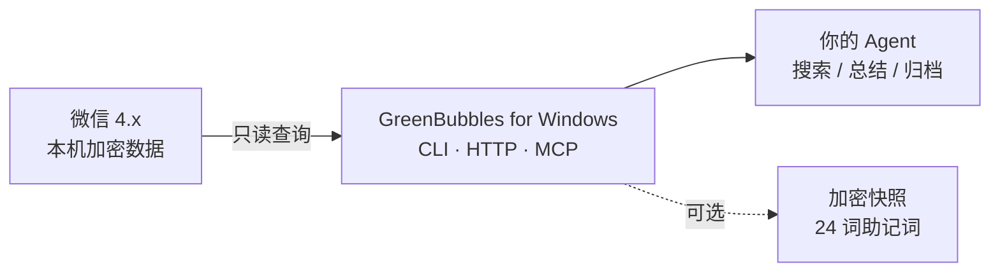

<p align="center">
  
</p>

<h1 align="center">GreenBubbles for Windows</h1>

<p align="center">
  <strong>把你自己的微信聊天记录，变成 Agent 可读的本地数据源。</strong><br>
  Read-only CLI + HTTP connector + MCP server for Windows WeChat 4.x.<br>
  Everything stays on this machine.
</p>

<p align="center">
  <a href="#快速开始">快速开始</a> ·
  <a href="#常用命令">常用命令</a> ·
  <a href="#给-agent-用">给 Agent 用</a> ·
  <a href="#归档与加密快照">归档</a> ·
  <a href="https://github.com/bojieli/greenbubbles">上游项目</a> ·
  <a href="docs/README.md">文档</a> ·
  <a href="docs/ARCHITECTURE.md">架构</a> ·
  <a href="#贡献者">贡献者</a> ·
  <a href="README.md">English</a> ·
  <a href="CONTRIBUTING.md">参与贡献</a>
</p>

<p align="center">
  <a href="https://github.com/seaneer/greenbubbles-win/actions/workflows/ci.yml"></a>
  <a href="LICENSE"></a>
  
  
  
  
  
</p>



<sub>架构图由 Markdown（Mermaid）直接渲染，不依赖图床或 CDN。静态备份：[assets/architecture.zh-CN.png](assets/architecture.zh-CN.png)；设计说明：[docs/ARCHITECTURE.md](docs/ARCHITECTURE.md)。</sub>

> **上游参考项目：** [Bojie Li 的 macOS 版 GreenBubbles](https://github.com/bojieli/greenbubbles)（MIT）。本项目是独立的 Windows 实现，不是上游的 fork，也不是 Windows 分支。

## English

GreenBubbles for Windows reads the WeChat 4.x databases that already exist on
your own PC and exposes them through one read-only query contract to a CLI, a
local HTTP connector and an MCP server. There is no export step and no second
chat database: attachments are materialised only when asked for, and every
query stays on this machine.

- Browse, page and time-filter one conversation, or search the whole history.
- Export Markdown / JSONL / HTML archives, including images and files.
- Let an agent read the same data over `127.0.0.1` or stdio MCP.
- Seal an archive as a BIP39 + Argon2id + ChaCha20-Poly1305 snapshot.

It does **not** write to WeChat, send messages, sync to a cloud, or read anyone
else's account. It is a way to see your own records.

## 中文

GreenBubbles for Windows 是 macOS 项目 [GreenBubbles](https://github.com/bojieli/greenbubbles) 的独立 Windows 实现。
它直接读微信 4.x 已经存在的加密数据库，**没有导出步骤，也不维护第二份聊天库**；查询结果通过同一份
`greenbubbles.query.v1` 契约交给命令行、HTTP 客户端或 MCP 宿主。

- 给人用：浏览、搜索、按时间段读某个联系人或群，导出 Markdown / JSONL / HTML 归档，连图片和文件一起落盘。
- 给 Agent 用：常驻 HTTP 接口或 stdio MCP，工具名与上游一致，已有 Agent 代码基本不用改。
- 给未来用：把归档封成 BIP39 + Argon2id + ChaCha20-Poly1305 的加密快照，换机器后离线可查。

> **它不是什么**：不写微信数据库、不发消息、不做云同步、不支持读取他人账号。只是「让自己看见自己的记录」。

### 与上游 greenbubbles 的差异

| 项目 | 上游（macOS） | 本项目（Windows） |
| --- | --- | --- |
| 支持平台 | macOS 14+ | Windows 10/11 x64 |
| 实现 | Swift + SQLCipher | Python 3.10+ |
| 数据源 | macOS 微信 | Windows 微信 4.x（实测 4.1.11.24） |
| 入口 | Swift CLI / GUI | CLI + HTTP Connector + MCP |
| 查询契约 | `greenbubbles.query.v1` | 同名同义，字段只增不删 |
| 代码关系 | MIT | 独立实现，不包含上游 Swift 源码 |

本项目不是上游的 Windows 分支，也不保证与上游每个命令一一对应；能对齐的是
查询信封、消息类型映射、`sortSequence` 排序和 MCP 工具名。

---

## 目录

- [为什么需要它](#为什么需要它)
- [功能](#功能)
- [快速开始](#快速开始)
- [常用命令](#常用命令)
- [给 Agent 用](#给-agent-用)
- [归档与加密快照](#归档与加密快照)
- [查询契约](#查询契约)
- [性能](#性能)
- [项目结构](#项目结构)
- [安全与隐私](#安全与隐私)
- [已知限制](#已知限制)
- [开发与测试](#开发与测试)
- [Roadmap](#roadmap)
- [贡献者](#贡献者)
- [致谢与许可](#致谢与许可)

## 为什么需要它

微信 PC 端把历史存在 SQLCipher 加密的 `db_storage` 里，密钥只在登录后的进程内存中。想让 Agent 帮你整理会议纪要、
复盘项目群、归档客户沟通，通常得先「导出聊天记录」——要么功能受限，要么把明文散落到各种临时目录。

这个项目换一条路：**原地只读解密 + 统一查询契约**。数据不搬家，Agent 按需取指定会话、指定时间段，
附件按需落盘；需要带走时再生成加密快照。

## 功能

| 能力 | 说明 |
| --- | --- |
| 密钥捕获 | 从运行中的 `Weixin.exe` 只读内存取密钥，每个库的 HMAC 全部通过才写入 `state/keys.json` |
| 数据库解密 | SQLCipher 4 页级解密 + WAL 回放，多个分片库（含 FTS / resource）跨库合并，按 `sort_seq` 稳定排序 |
| 消息读取 | 会话列表 / 按名字查找 / 按时间段读 / 游标分页 / 单条精确回取 |
| 全文搜索 | 单会话实时搜索约 1.5 秒；全库走本地索引约 2 秒 |
| 附件实体 | 图片 `.dat` 解密为 PNG/JPEG/GIF/WEBP，文件与视频按月份目录复制 |
| 归档 | `archive export/update`，输出 Markdown、JSONL、HTML，支持增量与幂等 |
| HTTP Connector | `127.0.0.1:8787`（可 `--host 0.0.0.0` 开局域网），9 条路由，Bearer token，附带 OpenAPI 描述 |
| MCP Server | stdio，6 个工具，协议版本 `2024-11-05` |
| 加密快照 | 24 词助记词 + Argon2id + ChaCha20-Poly1305，可离线恢复 |
| 回归测试 | 67 个用例覆盖 14 个历史 bug 与三入口契约，约 135 秒 |

## 快速开始

### 普通用户（Release 便携包）

下载 `greenbubbles-win-<version>-portable.zip`，解压到任意目录，然后运行：

```powershell
.\greenbubbles.cmd source status
```

便携包自带 Python 3.12 运行时，**不需要安装 Python、pip、Visual Studio 或任何编译工具**。
微信需要已经登录并保持运行，以便首次读取数据库密钥。

### 开发者（源码）

**前置**：Windows 10/11 x64、微信 4.x 已登录并运行、Python 3.10+。

```powershell
git clone <this-repo> greenbubbles-win
cd greenbubbles-win
python -m venv .venv
.venv\Scripts\pip install -r requirements.txt
```

发布构建使用锁定版本：`pip install -r requirements.lock`；普通安装仍用
`requirements.txt` 的兼容范围。

如果要从源码打出便携包：

```powershell
powershell -NoProfile -ExecutionPolicy Bypass -File .\scripts\build-portable.ps1
```

发布物输出到 `dist\greenbubbles-win-<version>-portable.zip`，并生成 `.sha256`。

先确认能拿到密钥、能看见会话：

```powershell
.\greenbubbles.cmd source status
```

输出里应看到 `keys.databases > 0`、`readiness.conversations > 0`、`media.v2Key = derived`。
如果数据目录不在默认位置，加 `--db-root <账号目录>\db_storage`。

> 首次运行会解密全部数据库到 `state\cache\`（约 745 MB，十几秒到几十秒）；之后按源文件 mtime 增量刷新。
> 微信不需要一直开着——只要 `state\keys.json` 还在，就能读缓存的库。

### 系统要求

| 角色 | 需要 |
| --- | --- |
| 普通用户 | Windows 10/11 x64；微信 4.x；解压便携包即可，无需 Python |
| 开发者 | Windows 10/11 x64；Python 3.10+；pip；Git |
| 权限 | 通常普通用户即可；若微信以管理员身份运行，本工具也需以管理员身份启动 |
| 架构 | 目前只提供 x64；ARM64 未验证 |
| 网络 | 不需要外网；HTTP 默认只监听 `127.0.0.1` |

## 常用命令

```powershell
# 最近会话 / 按名字找
.\greenbubbles.cmd chats --limit 20
.\greenbubbles.cmd chats find 项目群

# 读某个群 8 月 10 日以来的消息（游标分页，page.nextCursor 传 --cursor）
.\greenbubbles.cmd messages list --conversation 12345678901@chatroom --since 2026-08-10 --limit 100

# 搜索：单会话实时；不带 --conversation 时走本地索引
.\greenbubbles.cmd messages search --query keyword --conversation 12345678901@chatroom --limit 20

# 带附件信息 / 单条精确回取
.\greenbubbles.cmd messages list --conversation <id> --with-media --limit 20
.\greenbubbles.cmd message get --conversation <id> --message-id <local_id>

# 归档（含附件实体）
.\greenbubbles.cmd archive export --out .\archive --formats md,jsonl,html --attachments --conversation <id>
.\greenbubbles.cmd archive update --out .\archive --attachments

# 全库索引（首次 74–100 秒，之后增量）
.\greenbubbles.cmd index build
.\greenbubbles.cmd index status

# 服务
.\start-connector-bg.cmd      # A：后台常驻，监听 0.0.0.0:8787（双击同效）
.\start-connector-local.cmd   # B：只监听 127.0.0.1:8787，配合 ssh -L 隧道
.\connector-status.cmd        # 查看 PID / 端口 / health
.\stop-connector.cmd          # 停止 A
.\stop-connector-local.cmd    # 停止 B
.\start-connector.cmd         # 或前台启动，Ctrl+C 停止
.\greenbubbles.cmd mcp        # MCP stdio
```

后台启停的 PID、日志与排查见 [docs/SERVICE.md](docs/SERVICE.md)；不注册计划任务、不会开机自启。

## 给 Agent 用

**推荐 HTTP（后台常驻，B 模式）**：

```powershell
.\start-connector-local.cmd
# 令牌：state\token.txt（首次启动生成；重启沿用，删除后重启即轮换）
```

本机 Agent 直接请求 `http://127.0.0.1:8787`；跨机调用走 SSH 隧道，连接器始终只监听回环。

### 跨机：Windows 开启 OpenSSH Server（一次性，管理员）

```powershell
Add-WindowsCapability -Online -Name OpenSSH.Server~~~~0.0.1.0
Set-Service sshd -StartupType Automatic
Start-Service sshd
New-NetFirewallRule -DisplayName "OpenSSH 22" -Direction Inbound -Protocol TCP -LocalPort 22 -Action Allow
```

验证：

```powershell
Get-WindowsCapability -Online -Name OpenSSH.Server*   # 应为 Installed
Get-Service sshd                                       # 应为 Running
```

若卡在 `InstallPending`，改用官方签名的 Win32-OpenSSH 发布包；完整步骤与回退见
[docs/SERVICE.md](docs/SERVICE.md) 的 B2 节。

### 跨机：调用方建隧道并取令牌

```bash
ssh -N -L 8787:127.0.0.1:8787 <windows-user>@<windows-ip>

# 隧道只转发端口，不转发令牌；通过可信渠道把 Windows 侧 token 取到调用方一次
scp '<windows-user>@<windows-ip>:D:/path/to/greenbubbles-win/state/token.txt' ~/.greenbubbles-token
chmod 600 ~/.greenbubbles-token
```

```bash
curl -H "Authorization: Bearer $(cat ~/.greenbubbles-token)" \
  "http://127.0.0.1:8787/api/v1/messages?conversation=12345678901@chatroom&since=2026-08-10&limit=200"
```

令牌等同密码：不要写进提示词、代码仓库或共享日志。

**MCP**（Claude Desktop / Cursor 等）：

```json
{
  "mcpServers": {
    "greenbubbles": {
      "command": "C:\\path\\to\\greenbubbles-win\\greenbubbles.cmd",
      "args": ["mcp"],
      "cwd": "C:\\path\\to\\greenbubbles-win"
    }
  }
}
```

工具：`list_conversations`、`get_messages`、`search_messages`、`list_contacts`、`get_message`、`source_status`。
完整参数、错误码与鉴权方式见 [docs/INTERFACE.md](docs/INTERFACE.md)，OpenAPI 见 [docs/openapi.json](docs/openapi.json)。

给其他 Agent 的现成提示词在 [docs/AGENT-PROMPT.md](docs/AGENT-PROMPT.md)；局域网内也可以让它直接取
`GET /guide`（需 token），不必手工复制。

## 归档与加密快照

```powershell
# 全量导出（Markdown + JSONL + HTML + 附件）
.\greenbubbles.cmd archive export --out D:\archive\wechat --formats md,jsonl,html --attachments

# 增量：按 watermark 只追加新消息，可反复执行
.\greenbubbles.cmd archive update --out D:\archive\wechat --attachments

# 加密快照：24 词助记词只显示一次，务必分开抄走
.\greenbubbles.cmd snapshot create --out-dir D:\archive\wechat --file D:\archive\wechat.gbvault
.\greenbubbles.cmd snapshot restore --file D:\archive\wechat.gbvault --mnemonic "<24 words>" --out-dir D:\restore
```

## 查询契约

所有入口返回同一结构（`greenbubbles.query.v1`）：

```json
{
  "schema": "greenbubbles.query.v1",
  "formatVersion": 1,
  "operation": "messages.list",
  "ok": true,
  "source": { "mode": "live", "identity": "acct_..." },
  "consistency": {
    "guarantee": "read-only snapshot",
    "databaseCount": 13,
    "crossDatabaseAtomic": false,
    "coverageComplete": true,
    "observedAtUnixMilliseconds": 1793...
  },
  "page": { "limit": 100, "returned": 100, "hasMore": true, "nextCursor": "..." },
  "warnings": [],
  "items": [ { "conversationId": "...", "sortSequence": 123, "createdAt": "2026-08-10T09:12:00+08:00", "text": "..." } ]
 }
```

两条硬约定：

1. **翻页看 `page.nextCursor`**，不要自己猜 offset；单页上限 500。
2. **会话不存在仍是 `ok: true`**，必须检查 `warnings[].code == "conversationNotFound"` 与 `coverageComplete`。

## 性能

本机实测（微信 4.1.11.24，缓存已预热，793 条消息的群）：

| 操作 | CLI | HTTP |
| --- | --- | --- |
| 进程启动 | 1.3–1.5 s | 常驻 |
| `source status` | 1.27 s | 0.17 s |
| 793 条全量翻页（8 页） | 11.65 s | 0.43 s |
| 单会话搜索 | 1.49 s | — |
| 全库搜索（索引） | 2.07 s | 0.78 s |
| 全库搜索（实时，未建索引） | 48–65 s | — |
| 索引全量构建 | 74–100 s | — |
| 回归套件（67 例） | 135 s | — |

## 项目结构

```
.
├── src/greenbubbles_win/        # 实现代码（14 个模块）
│   ├── keys.py  paths.py        # 密钥捕获、账号发现
│   ├── crypto.py  store.py      # 页级解密、WAL、分片定位
│   ├── content.py  media.py     # 内容解码、附件解密
│   ├── query.py  index.py       # 查询契约、本地索引
│   ├── service.py  mcp.py       # HTTP Connector、MCP server
│   ├── archive.py  snapshot.py  # 归档、加密快照
│   └── cli.py                   # 子命令
├── tests/                       # 67 个回归用例（stdlib unittest）
├── docs/                        # 接口、架构、回归、限制、FAQ、OpenAPI
├── scripts/
│   ├── run-tests.cmd
│   ├── build-portable.ps1       # 打自带 Python 运行时的便携包
│   └── connector-service.ps1    # 后台启停连接器
├── assets/                      # 图标与架构图
├── skills/greenbubbles-win/     # Agent 技能说明
├── .github/workflows/ci.yml     # Windows CI（无数据时自动跳过）
├── greenbubbles.cmd             # CLI 启动器
├── start-connector-bg.cmd       # A：后台启动（0.0.0.0，手动停止）
├── start-connector-local.cmd    # B：后台启动（127.0.0.1，SSH 隧道）
├── stop-connector.cmd           # 停止 A
├── stop-connector-local.cmd     # 停止 B
├── connector-status.cmd         # 查看运行状态
├── start-connector.cmd          # 前台启动连接器
├── pyproject.toml               # 打包元数据与 console script
└── state/                       # 运行时数据（gitignored）
```

与上游 macOS 版对应关系：`Sources/` ↔ `src/greenbubbles_win/`，`Tests/` ↔ `tests/`，
`docs/`、`skills/` 保持同名同义。

## 安全与隐私

- 只读打开微信数据；解密副本、密钥、索引都在本机 `state/`（或 `GREENBUBBLES_HOME`），已加入 `.gitignore`。
- 无任何主动外连；`serve` 与 B 模式默认只绑 `127.0.0.1`，A 模式显式绑 `0.0.0.0`（仅限可信内网），除 `/health` 外都要 Bearer token。
- `state/keys.json` 等同密码：泄露即可解全部历史。不要提交、不要发给任何人。
- 快照助记词只显示一次；丢失无法恢复。
- 详见 [SECURITY.md](SECURITY.md) 与 [PRIVACY.md](PRIVACY.md)。

## 已知限制

语音（`msg_type 34`）尚未解码；`wxgf` 是 HEVC 容器，需要转码才能直接查看（连接器会校验 key，但不会自动转 PNG）；未下载的附件取不到；
未建索引时全库搜索需要 48–65 秒。完整列表见 [docs/KNOWN_LIMITATIONS.md](docs/KNOWN_LIMITATIONS.md)。

## 开发与测试

```powershell
.venv\Scripts\pip install -e .
.\scripts\run-tests.cmd                       # 67 用例，约 135 秒
.venv\Scripts\python -m unittest tests.test_units -v   # 纯单元层，秒级
```

没有微信数据时，数据相关用例会自动 skip；CI 因此可以在干净的 Windows runner 上跑。
每个 bug 修复都要在 [docs/REGRESSION-TESTS.md](docs/REGRESSION-TESTS.md) 登记一个用例。

## Roadmap

- [ ] 语音消息 silk → wav 解码
- [ ] `wxgf` 自动转 PNG 预览（当前只做 key 校验与 HEVC 解码验证）
- [ ] 增量推送（文件变更监听），替代轮询
- [ ] 归档浏览器的全文检索（当前 HTML 为静态页）
- [ ] 多账号并行状态目录的一键切换

## 贡献者

| 贡献者 | 角色 |
| --- | --- |
| [seaneer](https://github.com/seaneer) | Windows 实现、CLI/HTTP/MCP、文档与发布 |
| [豆包工作 / Doubao Work（官方）](https://www.doubao.com) | 参与实现、测试与文档的 AI 结对编程支持 |
| [Bojie Li](https://github.com/bojieli/greenbubbles) | 上游 macOS GreenBubbles 作者 |

本表是项目的正式贡献者名单。GitHub 自动生成的 Contributors 面板还可能显示
`claude`、`github-actions[bot]` 等上游自动化账号；它们属于上游项目，不是本 Windows 实现的贡献者。

## 致谢与许可

- 上游：[GreenBubbles](https://github.com/bojieli/greenbubbles)（macOS，Swift，MIT，Copyright © 2026 Bojie Li）。
  本项目的查询契约、消息类型映射与只读设计沿用其语义，未复制其代码。
- Windows 实现：[@seaneer](https://github.com/seaneer) 与[豆包工作](https://www.doubao.com)共同完成；代码、文档与发布物以 MIT 许可证提供。
- 依赖与许可证见 [THIRD_PARTY_NOTICES.md](THIRD_PARTY_NOTICES.md)。
- 本项目以 MIT 许可证发布，详见 [LICENSE](LICENSE) 与 [NOTICE.md](NOTICE.md)。

微信 / Weixin / Tencent 是腾讯公司的商标，本项目与腾讯无关联。

与上游一样，本项目是**未获腾讯官方授权**的独立互操作实现，只读取本机已登录账号的本地数据。分发或使用前请自行评估腾讯用户协议、当地法律与组织合规要求；作者不对数据获取的可用性、完整性或特定用途适用性作任何担保。

